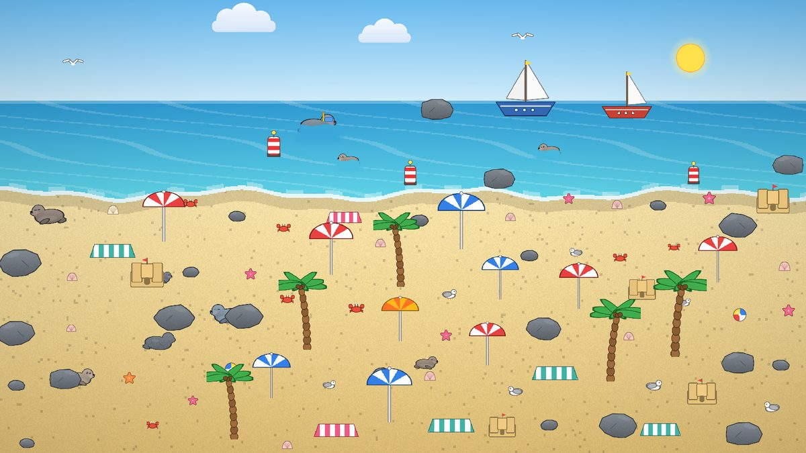
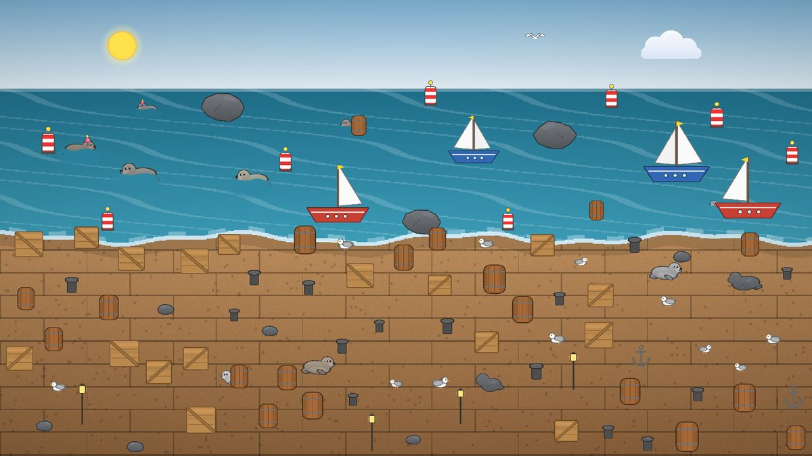
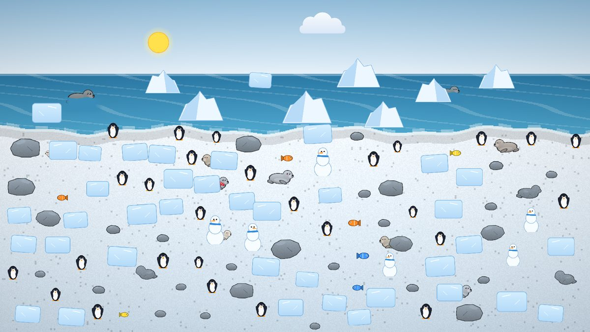
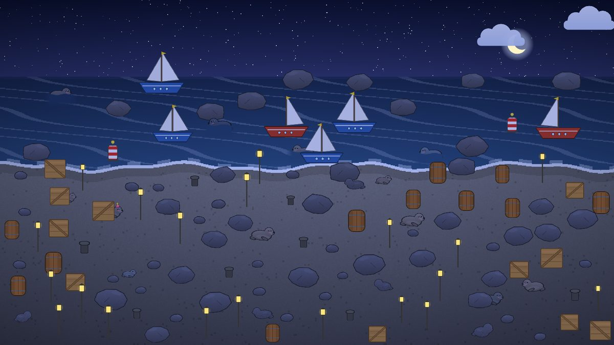
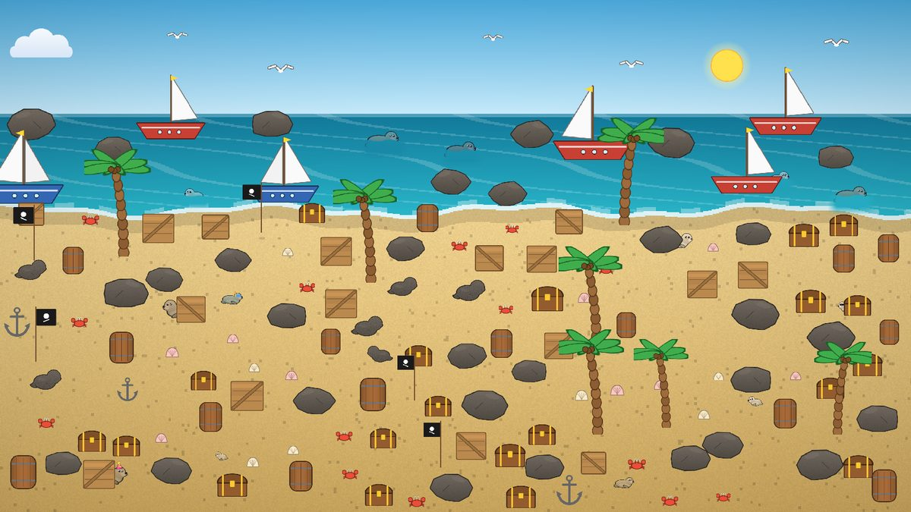
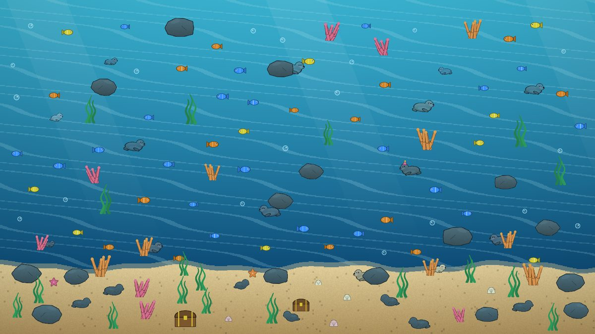
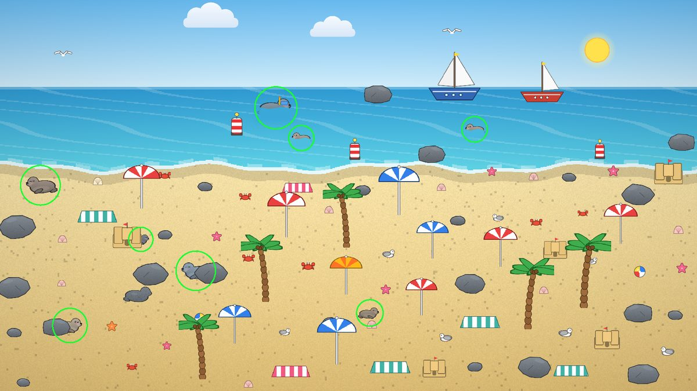

# Robben-Suche 🦭

Ein gemütliches Wimmelbild-Spiel für Unity: In detailreichen Szenen verstecken sich Robben –
hinter Steinen, zwischen Kisten, im Wasser, schlafend im Sand oder als Babyrobbe zwischen Pinguinen.
Finde sie alle, sammle seltene Arten und knacke deine Bestzeit.



| Hafen | Eiswelt | Nacht |
|---|---|---|
|  |  |  |
| **Pirateninsel** | **Unterwasser** | **Lösung (Strand)** |
|  |  |  |

> Alle Bilder oben wurden direkt aus dem Spielcode erzeugt – das Projekt enthält **keine einzige
> Bild- oder Audiodatei**. Grafiken und Sounds entstehen prozedural zur Laufzeit.

## Schnellstart

1. **Unity Hub** → *Add project from disk* → diesen Ordner wählen.
   Empfohlen: **Unity 6 (6000.0 LTS)**. Für Unity 2022.3 LTS in `Packages/manifest.json`
   `com.unity.ugui` auf `1.0.0` und `com.unity.test-framework` auf `1.1.33` setzen.
2. Projekt öffnen. Beim ersten Öffnen legt `ProjectSetup` automatisch `Assets/Scenes/Main.unity` an,
   trägt sie in die Build-Settings ein und stellt Querformat + App-Namen ein.
   (Manuell: Menü **Robben-Suche → Projekt einrichten**.)
3. **Play** drücken. Fertig.

Das Spiel startet sich übrigens in *jeder* Szene selbst (`GameBootstrap`) – auch in einer leeren.

**Steuerung:** Tippen/Klicken = Robbe finden · Ziehen = Bild verschieben ·
Zwei Finger bzw. Mausrad = Zoomen · Escape/Android-Zurück = Pause/Zurück.

**Handy-Build:** *File → Build Profiles* → Android oder iOS → *Build*.

## Was das Spiel ausmacht

Kern-Moment: **„OH, DA IST SIE! 😂"** – alles im Spiel arbeitet auf diesen Moment hin.

| Feature | Beschreibung |
|---|---|
| **7 Welten** | Strand, Hafen, Eiswelt, Sonnenuntergang, Nacht, Pirateninsel, Unterwasser – jede mit eigener Palette, Deko und Ablenkern (Pinguine, Fische, Möwen …) |
| **42 Level** | 6 pro Welt mit wechselnden Aufgaben: *Finde X Robben*, *Finde die Babyrobben*, *Finde Robben mit Sonnenbrille/Schal/Piratenhut …*, *Gegen die Uhr*, *Finale* |
| **8 Versteck-Arten** | frei, halb hinter Deko, nur Kopf im Wasser, taucht ab und auf, schwimmt herum, winzig, schläft (Zzz), **Trickser** (hüpft beim ersten Tipp weg: „Hihi!") |
| **Köder** | Robbenförmige Steine – „Warte … ist DAS eine Robbe?!" |
| **29 sammelbare Robben** | 5 Seltenheitsstufen von *Häufig* bis *Legendär*, jede mit Namen und Spruch („Bruno – Liebt Fische und hasst Montage.") |
| **Fehlklick-Strafe** | +2 s pro Fehlklick, steigend bei wildem Herumtippen (max. +5 s) |
| **Combos** | Schnelle Funde hintereinander multiplizieren die Punkte (bis x5) |
| **„psst …"** | Wer lange nichts findet, hört eine Robbe flüstern – mit Richtungstipp |
| **Lupe** | 3 aktive Hinweise pro Level (+5 s Strafe): Kamera fährt in die Nähe, Ring markiert grob die Stelle |
| **Sterne & Freischalten** | 1–3 Sterne nach Zeit; Sterne schalten neue Welten frei |
| **Tages-Challenge** | Jeden Tag ein neues Bild – für alle Spieler gleich (Seed = Datum) – mit Serien-Zähler |
| **Zufallsrunden** | Nach der Kampagne: unendlich viele neue Wimmelbilder |
| **Juice** | Pop-Animationen, Konfetti, Funken, Wasserspritzer, Combo-Texte, Bildschirm-Wackeln, Haptik |

Mehr Details zu Spielregeln, Balancing und Ideen für später: [`docs/GAME_DESIGN.md`](docs/GAME_DESIGN.md).

## Projektstruktur

```
Assets/SealFind/
├─ Scripts/
│  ├─ Core/        GameManager (Ablauf & Verdrahtung), GameBootstrap, SaveSystem, Tweener
│  ├─ Data/        ContentDatabase (Welten, Robben, Level-Kurve), Definitionen, PropCatalog
│  ├─ Generation/  SceneGenerator (Wimmelbild-Erzeugung), PoissonDisc, SeededRandom, ScenePlan
│  ├─ Art/         PixelCanvas (SDF-Zeichnen), ArtLibrary (alle Sprites), SealRig, BackgroundPainter
│  ├─ Gameplay/    LevelSession (Regeln), Seal (Verhalten), SceneBuilder, Kamera, Eingabe, Punkte
│  ├─ FX/          FxSystem (Partikel-Pool)
│  ├─ Audio/       SynthAudio (Sound-Synthese), AudioManager
│  └─ UI/          UIKit (Baukasten), alle Bildschirme, UIRoot
├─ Editor/         ProjectSetup (Szene + Player-Settings automatisch)
└─ Tests/EditMode/ NUnit-Tests (Generator, Regeln, Spielstand, Inhalte)
Tools/OfflineCheck/ Tests & Vorschau-Renderer ohne Unity (.NET 8)
docs/              Game Design & Vorschaubilder
```

### Architektur in einem Satz pro Baustein

- **Daten statt Szenen:** Welten, Robben und Level sind reine C#-Daten (`ContentDatabase`). Neue Robbe = ein Eintrag.
- **Generator ist pur:** `SceneGenerator` erzeugt aus *Welt + Level + Seed* einen `ScenePlan` (nur Daten, keine GameObjects).
  Gleicher Seed = gleiches Bild → Tages-Challenge & Tests funktionieren deterministisch.
- **SceneBuilder** macht aus dem Plan GameObjects; **Seal** kümmert sich um Animation und Trefferprüfung.
- **LevelSession** kennt nur Regeln und meldet alles über Events; der **GameManager** verbindet sie mit UI, Sound und Effekten.
- **UI komplett im Code** (`UIKit`) – keine Prefabs, keine Inspector-Verknüpfungen, alles nachvollziehbar.

### Wie entsteht ein Wimmelbild?

1. Bild in Zonen teilen: Himmel / Wasser / Boden (pro Welt definiert).
2. Deko per **Poisson-Disc-Sampling** verteilen – gleichmäßig, aber natürlich.
3. Robben-Besetzung wählen (Ziel-Robben passend zur Aufgabe, Extra-Robben, evtl. legendärer Bonus).
4. Jede Robbe mit Versteck-Stil platzieren (z. B. seitlich hinter einer Kiste, Kopf zeigt nach außen).
5. Robbenförmige Köder-Steine verteilen.
6. Deko entfernen, die eine Robbe *unfair* komplett verdecken würde.

## Tests

**In Unity:** *Window → General → Test Runner → EditMode → Run All* (241 Tests).

**Ohne Unity** (z. B. auf dem Server/CI, benötigt .NET 8 SDK):

```bash
cd Tools/OfflineCheck/Tests && dotnet test          # gleiche EditMode-Tests
cd Tools/OfflineCheck/Preview && dotnet run -- out/ # rendert alle Welten als PNG (+ Lösungsbilder)
cd Tools/OfflineCheck/Preview && dotnet run -- out/ 4 5   # nur Welt 5, Level 6
```

Die Offline-Werkzeuge kompilieren die echten Spiel-Skripte gegen einen kleinen Ersatz für die
Unity-Mathe-Typen (`Tools/OfflineCheck/Shim`). So lässt sich jede Änderung am Generator sofort prüfen und *ansehen*.

## Eigene Inhalte ergänzen

- **Neue Robbe:** in `ContentDatabase.BuildSpecies()` eine Zeile `S("id", "Name", SealRarity.Rare, "#RRGGBB", "Spruch", ...)`.
- **Neue Welt:** in `ContentDatabase.BuildWorlds()` Farben, Zonen-Höhen und Deko-Regeln eintragen.
- **Neues Deko-Objekt:** `PropKind` erweitern, Größe in `PropCatalog`, Zeichnung in `ArtLibrary.DrawProp`.
- **Echte Grafiken statt Prozedural:** `ArtLibrary`-Methoden geben einfach geladene Sprites zurück – der Rest bleibt gleich.
- **Balancing:** Level-Kurve in `ContentDatabase.BuildLevel`, Punkte/Sterne in `ScoreCalculator`.

## Hinweise

- Eingabe nutzt den klassischen Input Manager (kein Input-System-Paket nötig).
- Texte nutzen die eingebaute Unity-Schrift (keine TextMeshPro-Essentials nötig).
- Spielstand: JSON in `Application.persistentDataPath` (Menü *Robben-Suche → Spielstand löschen*).
